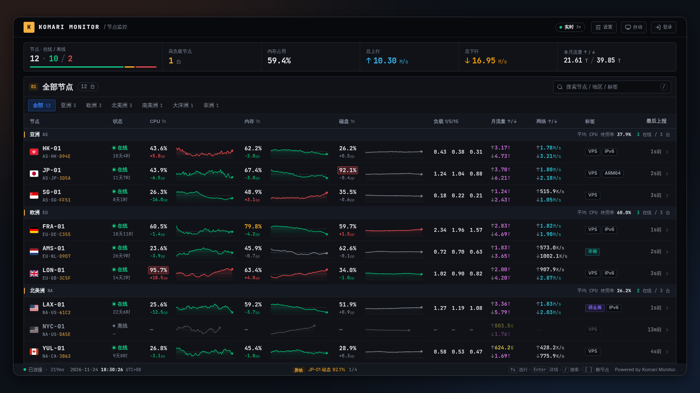

<h1 align="center">Komari Theme Stock</h1>

<p align="center">面向 VPS 节点的 <a href="https://github.com/komari-monitor/komari">Komari</a> 监控主题：集中查看节点在线状态、资源使用率和网络流量，并通过历史指标排查异常。</p>

<p align="center">
  <a href="https://github.com/MR-MonkeyRay/komari-theme-stock/actions/workflows/ci.yml"></a> <a href="./LICENSE"></a>
</p>

## 核心亮点

- **查看节点运行状态。** 首页汇总在线和离线节点数、资源使用率及网络流量。节点列表支持按大洲或后台分组，也可搜索和排序；CPU、内存和磁盘列默认同时显示当前使用率和近 1 小时趋势。
- **回溯资源与网络变化。** 节点详情以 K 线展示 CPU 使用率、内存用量和磁盘用量。CPU 使用率与上下行速率共用时间轴，便于对照同一时段的变化；缺测区间留空。
- **自定义显示。** 支持深色、浅色或跟随系统，也可单独切换指标上升与下降的颜色。
- **使用键盘导航。** `/` 聚焦搜索；聚焦节点列表后，用 `↑` / `↓` 选择节点、`Enter` 打开详情；在详情中用 `[` / `]` 切换节点、`Esc` 返回。

## 快速安装

### 方式一：通过 GitHub 仓库地址导入（推荐）

1. 在 Komari 后台进入 **主题管理 → 导入远程主题**。
2. 填入 GitHub 仓库地址 `https://github.com/MR-MonkeyRay/komari-theme-stock`，检测后确认导入。

### 方式二：手动上传 ZIP

1. 从 [GitHub Releases](https://github.com/MR-MonkeyRay/komari-theme-stock/releases/latest) 下载 `komari-theme-stock-<版本>.zip` 附件，不要下载 `Source code` 压缩包。
2. 在 Komari 后台进入 **主题管理 → 上传主题**，上传 ZIP。

安装完成后，在 **Komari Theme Stock** 卡片上选择 **设为当前主题**。

## 快速开始

1. 打开 Komari 首页，在「全部节点」列表中按节点名、地区或标签搜索，找到要检查的节点。
2. 打开节点详情并选择时间范围。将光标移到 CPU 使用率图表上，可对照同一时段的 CPU 使用率与网络上下行速率。

## 界面预览

**VPS 监控概览**



**节点详情**


## 设置与数据口径

- **访客设置：** 首页「设置」可调整指标变化配色、近 1 小时趋势曲线、实时刷新间隔、详情默认时间范围和节点事件的显示。设置仅保存在当前浏览器；深浅色模式可通过顶栏按钮切换。
- **站点设置：** 后台的主题设置决定首页按大洲（默认）、后台分组或不分组展示。
- **流量：** 指标保留期覆盖当月至今且月度数据可用时，显示本月流量；否则显示节点上报的累计流量。详情可选时间范围受指标保留期限制。

## 本地预览

在仓库根目录用 Node.js 24（与 CI 一致）执行：

```bash
npm ci
npm run dev:mock
```

打开终端打印的地址，可查看 12 台模拟节点，无需 Komari 后端。

## 开发与打包

已安装依赖时，可把开发服务器指向本地 Komari 后端：

```bash
VITE_API_TARGET=http://127.0.0.1:25774 npm run dev
```

开发服务器将 `/api` 和 `/themes` 转发至该后端。也可在 `.env.local` 中设置 `VITE_API_TARGET`。

```bash
npm run package
```

可上传的主题 ZIP 位于 `release/komari-theme-stock-<版本>.zip`，包含根目录的 `komari-theme.json`、`preview.png` 和 `dist/`。向 `main` 推送或提交 PR 时，[CI](./.github/workflows/ci.yml) 会检查并打包；`main` 上尚未发布的 `komari-theme.json` 版本会生成对应的 GitHub Release。

修改页面模板时，保留 [`index.html`](./index.html) 中的站点标题和描述占位符；Komari 会在部署时替换它们。更多约定见 [Komari 主题开发指南](https://komari-document.pages.dev/dev/theme)。

## 许可证

[MIT](./LICENSE)
