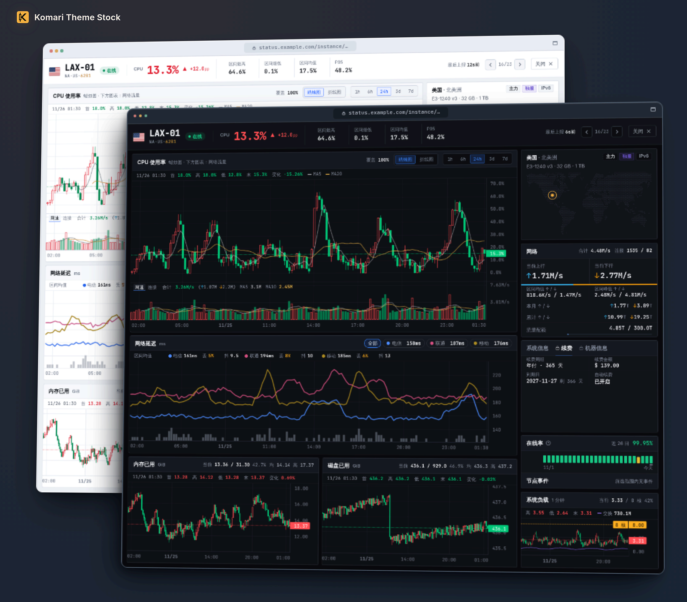

<h1 align="center">Komari Theme Stock</h1>

<p align="center">面向 VPS 节点的 <a href="https://github.com/komari-monitor/komari">Komari</a> 监控主题：集中查看节点在线状态、资源使用率和网络流量，并通过历史指标排查异常。</p>

<p align="center">
  <a href="https://github.com/MR-MonkeyRay/komari-theme-stock/actions/workflows/ci.yml"></a> <a href="./LICENSE"></a>
</p>

## 核心亮点

- **查看节点运行状态。** 首页汇总在线和离线节点数、高负载节点、内存占用和网络流量。节点列表支持按大洲或后台分组，也可搜索和排序；CPU、内存和磁盘列默认同时显示当前使用率和近 1 小时趋势，另列出 1 分钟负载、实时网速、本月流量和累计流量。
- **回溯资源与网络变化。** 节点详情以蜡烛图或折线图展示 CPU 使用率、内存用量、磁盘用量和系统负载。CPU 使用率与上下行速率共用时间轴，所有图表共享十字线、定位和缩放，便于对照同一时段的变化；缺测区间留空。网络延迟按探测线路分别绘制，并给出丢包和抖动（σ）。
- **判断负载是否过高。** 系统负载图用虚线标出逻辑核心数，负载越过虚线表示有任务在排队等待 CPU；使用了交换空间的节点会叠加显示交换用量。
- **追溯节点可用性。** 「节点事件」卡片顶部的在线率条按天显示最多 30 天的在线情况，柱子的颜色和高度都表示级别（正常、短暂离线、部分离线、严重离线）。点开某天可查看离线时段，点「在图表中查看」把所有图表定位到当天。下方列出从样本推断的 CPU 升高与回落、内存高和缺测等事件。
- **自定义显示。** 支持深色、浅色或跟随系统，可在蜡烛图和折线图之间切换，也可单独设置指标上升与下降的颜色。
- **多语言界面。** 界面语言跟随浏览器自动选择，支持简体中文、繁體中文、English、日本語、한국어、Русский、Deutsch、Français、Español、Português (Brasil) 和 Bahasa Indonesia；其他语言显示英文，也可在「设置」中手动切换。
- **使用键盘导航。** `/` 聚焦搜索；聚焦节点列表后，用 `↑` / `↓` 选择节点、`Enter` 打开详情；在详情中用 `[` / `]` 切换节点、`Esc` 返回。

## 快速安装

### 方式一：通过 GitHub 仓库地址导入（推荐）

1. 在 Komari 后台进入 **主题管理 → 导入远程主题**。
2. 填入 GitHub 仓库地址 `https://github.com/MR-MonkeyRay/komari-theme-stock`，检测后确认导入。

### 方式二：手动上传 ZIP

1. 从 [GitHub Releases](https://github.com/MR-MonkeyRay/komari-theme-stock/releases/latest) 下载 `komari-theme-stock-<版本>.zip` 附件，不要下载 `Source code` 压缩包。
2. 在 Komari 后台进入 **主题管理 → 上传主题**，上传 ZIP。

安装完成后，在 **Komari Theme Stock** 卡片上选择 **设为当前主题**。

## 快速开始

1. 打开 Komari 首页，在「全部节点」列表中按节点名、地区或标签搜索，找到要检查的节点。
2. 打开节点详情并选择时间范围。将光标移到 CPU 使用率图表上，可对照同一时段的 CPU 使用率与网络上下行速率。
3. 在「节点事件」卡片顶部的在线率条上点开某天，可查看当天的离线时段；点「在图表中查看」，所有图表会定位到这一天。

## 界面预览

**节点总览**


**节点详情**



**移动端：从总览到定位离线**


## 设置与数据口径

- **访客设置：** 首页「设置」可选择界面语言，调整升降配色、近 1 小时趋势线、实时刷新间隔、详情的默认时间范围、图表类型（蜡烛图或折线图），以及是否显示节点事件。设置仅保存在当前浏览器；深浅色模式可通过顶栏按钮切换。
- **站点设置：** 后台的主题设置决定首页按大洲（默认）、后台分组或不分组展示。
- **仅登录可见：** 登录 Komari 后台后，主题额外显示隐藏节点（带「隐藏」标记，可临时不显示）。详情页的「系统信息」旁多出两个标签页：「续费」显示续费周期、金额、到期日和自动续费；「机器信息」显示节点 IP（默认打码，可复制完整地址）、Agent 版本，以及 Komari 对该节点的离线通知设置和上次通知时间。续费金额等字段在 Komari 的公开接口里仍会下发给访客，主题只是不显示；需要真正保密时，请在后台开启私有站点，或不填写金额。
- **流量：** 指标保留期覆盖当月至今且月度数据可用时，显示本月流量；否则显示节点上报的累计流量。详情可选时间范围受指标保留期限制。
- **在线率：** Komari 不保存节点的在线和离线记录，主题按节点每小时上报的样本数推断每日在线率：没有上报的时段记为离线，与 Komari 的在线判定一致。全天离线不足约 3 分钟为正常，不足约 29 分钟为短暂离线，不足约 2.4 小时为部分离线，更长为严重离线。在线率条只显示 Komari 仍保留小时级数据的日子（默认保留 600 小时，约 25 天），节点添加之前的日子不显示。
- **系统负载：** 图表使用 Komari 记录的 1 分钟负载。卡片标题栏显示当前负载、逻辑核心数和两者之比；比值达到 100% 时以警示色显示，表示有任务在排队等待 CPU。

## 本地预览

在仓库根目录用 Node.js 24（与 CI 一致）执行：

```bash
npm ci
npm run dev:mock
```

打开终端打印的地址，可查看 23 台模拟节点，无需 Komari 后端。模拟节点的配置和负载水平参照一套真实部署，名称、分组、备注和价格均已改动。点击顶栏「登录」进入模拟的登录状态（多出 1 台隐藏节点和仅登录可见的内容），访问 `/__mock/logout` 退出。

## 开发与打包

已安装依赖时，可把开发服务器指向本地 Komari 后端：

```bash
VITE_API_TARGET=http://127.0.0.1:25774 npm run dev
```

开发服务器将 `/api` 和 `/themes` 转发至该后端。也可在 `.env.local` 中设置 `VITE_API_TARGET`。

```bash
npm run package
```

可上传的主题 ZIP 位于 `release/komari-theme-stock-<版本>.zip`，包含根目录的 `komari-theme.json`，以及 `docs/images/preview.png` 和 `dist/`。向 `main` 推送或提交 PR 时，[CI](./.github/workflows/ci.yml) 会检查并打包；`main` 上尚未发布的 `komari-theme.json` 版本会生成对应的 GitHub Release。

界面文案位于 `src/i18n/locales/`，以 `zh-CN.json` 为源。`npm run i18n:check` 检查各语言的键、复数形式、占位符和标签是否与源一致，构建时也会执行；新增语言时，在 `src/i18n/index.ts` 的 `LANGUAGES` 中登记。

修改页面模板时，保留 [`index.html`](./index.html) 中的站点标题和描述占位符；Komari 会在部署时替换它们。更多约定见 [Komari 主题开发指南](https://komari-document.pages.dev/dev/theme)。

## 许可证

[MIT](./LICENSE)
