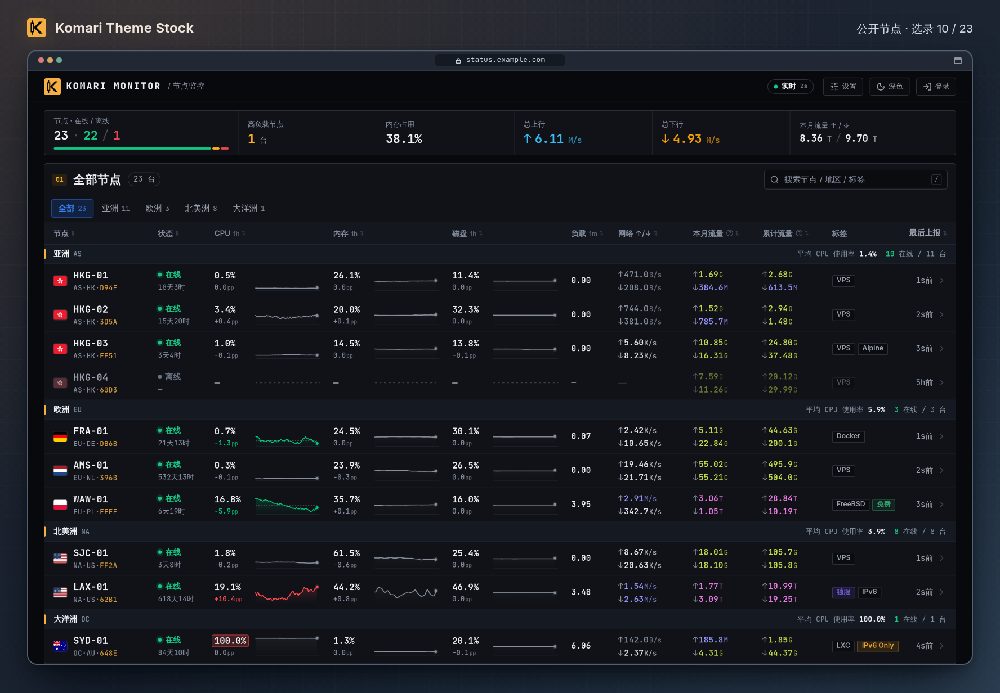

<h1 align="center">Komari Theme Stock</h1>

<p align="center">A stock-terminal-style theme for <a href="https://github.com/komari-monitor/komari">Komari</a> that puts VPS fleet status and per-node metric history in one view.</p>

<p align="center"><a href="./README.md">English</a> | <a href="./README.zh-CN.md">简体中文</a></p>

<p align="center">
  <a href="https://github.com/MR-MonkeyRay/komari-theme-stock/actions/workflows/ci.yml"></a> <a href="./LICENSE"></a>
</p>

## Highlights

- **Find nodes that need attention.** Filter the dashboard to offline or high-load nodes, or search and sort the fleet. The node list shows current CPU, memory and disk usage alongside one-hour trends, live network rates and traffic totals.
- **Compare resource and network changes.** Open a node to compare CPU, memory, disk and one-minute load on synchronized charts. The CPU chart aligns with upload and download rates; configured probes show latency, packet loss and jitter by task.
- **Investigate reporting gaps.** Open a day on the availability strip to see estimated offline intervals. When chart history covers that day, jump to it and pin the start of the first gap.

## Quick Install

You need an existing Komari instance and administrator access. For a useful dashboard on first launch, have at least one node reporting to Komari.

### Import from GitHub (recommended)

1. In the Komari admin panel, open **Theme Management → Import Theme**.
2. Paste `https://github.com/MR-MonkeyRay/komari-theme-stock`, then select **Check → Confirm Import**. Komari downloads the theme ZIP from the latest release.

### Upload a ZIP

1. Download the `komari-theme-stock-<version>.zip` asset from [GitHub Releases](https://github.com/MR-MonkeyRay/komari-theme-stock/releases/latest), not GitHub’s **Source code** archive.
2. In the Komari admin panel, open **Theme Management → Upload Theme** and select the ZIP.

After either method, select **Set as Active Theme** on the **Komari Theme Stock** card.

## Quick Start

1. Open the Komari home page. In **All nodes**, search by node name, region or tag, then open a node.
2. Select a time range in the CPU chart. Move the crosshair to a spike to compare CPU usage with upload and download rates at the same time.
3. To investigate missing reports, select a day under **Availability**. If **Show in charts** is available, select it to line up the charts with the selected day and the first reporting gap, if any.

## Screenshots




## Settings and metric definitions

- **Site settings:** Choose whether to group nodes by continent (the default), by Komari group, or not at all. Visitors can set the language, switch between light and dark appearance, and choose candlestick or line charts. Visitor preferences are stored in the current browser.
- **High load:** An online node counts as high-load at CPU usage of at least 80% or memory usage of at least 90%. This count does not use the one-minute system load value.
- **Availability and traffic:** Daily availability is estimated from hourly report counts for up to 30 days, subject to Komari’s data retention. Traffic totals that cover only part of the requested period are marked with their start date.
- **Billing privacy:** The theme only shows billing details to signed-in viewers, but Komari’s public node API can still return prices for public nodes. Leave prices unset if they must stay private on a public site.

## Local development

Use Node.js 26, as in [CI](./.github/workflows/ci.yml). From the repository root:

```bash
npm ci
npm run dev:mock
```

Open the address printed by Vite to see 23 public mock nodes without a Komari backend. Select **Log in** to see the simulated admin view, or visit `/__mock/logout` to return to the guest view.

To develop against a running Komari backend, use the Vite proxy. Replace the address if your backend listens elsewhere:

```bash
VITE_API_TARGET=http://127.0.0.1:25774 npm run dev
```

Run `npm run package` to build an installable archive at `release/komari-theme-stock-<version>.zip`. See the [Komari theme development guide](https://komari-document.pages.dev/dev/theme) for the package format.

## License

[MIT](./LICENSE)
