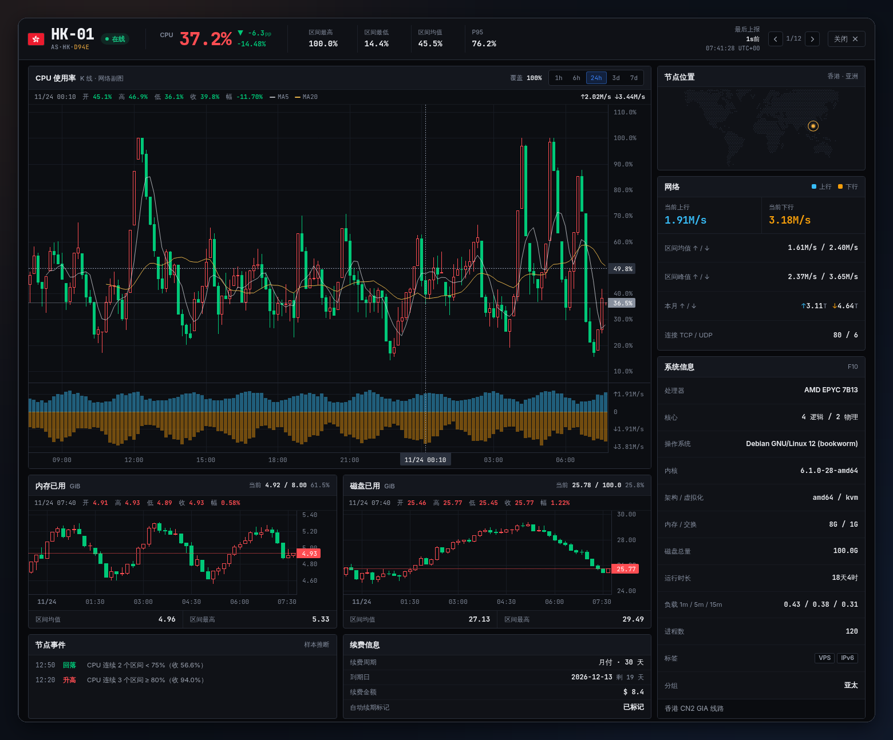

<h1 align="center">Komari Theme Stock</h1>

<p align="center">把 <a href="https://github.com/komari-monitor/komari">Komari</a> 监控首页变成行情终端：在报价表里比较节点，点开 K 线追踪资源变化。</p>

<p align="center">
  <a href="https://github.com/MR-MonkeyRay/komari-theme-stock/actions/workflows/ci.yml"></a> <a href="./LICENSE"></a>
</p>

## 核心亮点

- **找出异常节点。** 顶栏汇总在线状态、资源与流量；报价表按地区或后台分组，支持搜索和排序。CPU、内存和磁盘同时展示当前用量与近 1 小时走势。
- **追踪异常发生的时间。** 节点详情用 K 线展示 CPU、内存和磁盘。CPU 与上下行速率共用时间轴，便于对照变化；缺测区间留空。
- **选熟悉的配色。** 深色、浅色或跟随系统；红涨绿跌与绿涨红跌可单独切换。
- **用键盘浏览。** `/` 聚焦搜索；聚焦报价表后用 `↑` / `↓` 选节点、`Enter` 打开详情；详情中用 `[` / `]` 切换节点、`Esc` 返回。

## 快速安装

1. 从 [GitHub Releases](https://github.com/MR-MonkeyRay/komari-theme-stock/releases/latest) 下载附件 `komari-theme-stock-<版本>.zip`，不要下载 `Source code` 压缩包。
2. 在 Komari 后台进入 **主题管理 → 上传主题**，上传 ZIP。
3. 在已安装的 **Komari Theme Stock** 卡片上选择 **设为当前主题**。

也可以在 **主题管理 → 导入远程主题** 中填入 `https://github.com/MR-MonkeyRay/komari-theme-stock`，检测并确认导入后，再设为当前主题。

## 快速开始

1. 打开 Komari 站点首页，从报价表找一台有历史数据的节点。找不到时，可按节点名、地区或标签搜索。
2. 点击节点，打开详情并选择时间范围。将光标移到 CPU K 线上，可沿同一条时间轴查看对应的上行、下行速率。

## 界面预览

**首页报价表**


**节点详情**



## 设置与数据口径

- **访客设置：** 首页「设置」可调整涨跌配色、1 小时走势、实时刷新间隔、默认时间范围和节点事件。设置只保存在当前浏览器；深浅配色用顶栏按钮单独切换。
- **站点设置：** 后台的主题设置决定首页按大洲（默认）、后台分组或不分组展示。
- **流量：** 指标保留期覆盖当月至今且月度数据可用时，显示本月流量；否则显示节点上报的累计流量。详情可选时间范围受指标保留期限制。

## 本地预览

在仓库根目录用 Node.js 24（与 CI 一致）执行：

```bash
npm ci
npm run dev:mock
```

打开终端打印的地址，可查看 12 台模拟节点，无需 Komari 后端。

## 开发与打包

已安装依赖时，可把开发服务器指向本地 Komari 后端：

```bash
VITE_API_TARGET=http://127.0.0.1:25774 npm run dev
```

开发服务器将 `/api` 和 `/themes` 转发至该后端。也可在 `.env.local` 中设置 `VITE_API_TARGET`。

```bash
npm run package
```

可上传的主题 ZIP 位于 `release/komari-theme-stock-<版本>.zip`，包含根目录的 `komari-theme.json`、`preview.png` 和 `dist/`。向 `main` 推送或提交 PR 时，[CI](./.github/workflows/ci.yml) 会检查并打包；`main` 上尚未发布的 `komari-theme.json` 版本会生成对应的 GitHub Release。

修改页面模板时，保留 [`index.html`](./index.html) 中的站点标题和描述占位符；Komari 会在部署时替换它们。更多约定见 [Komari 主题开发指南](https://komari-document.pages.dev/dev/theme)。

## 许可证

[MIT](./LICENSE)
