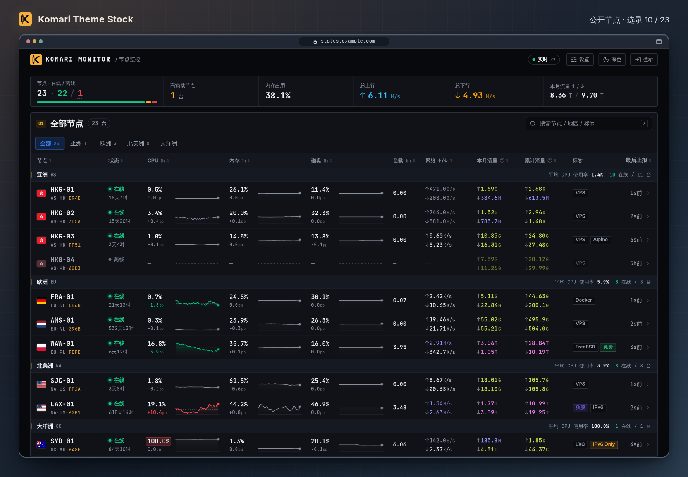
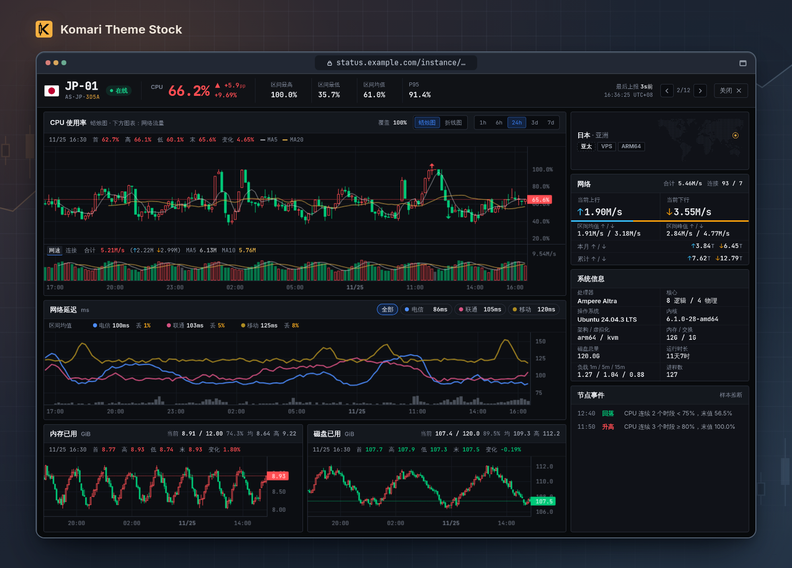
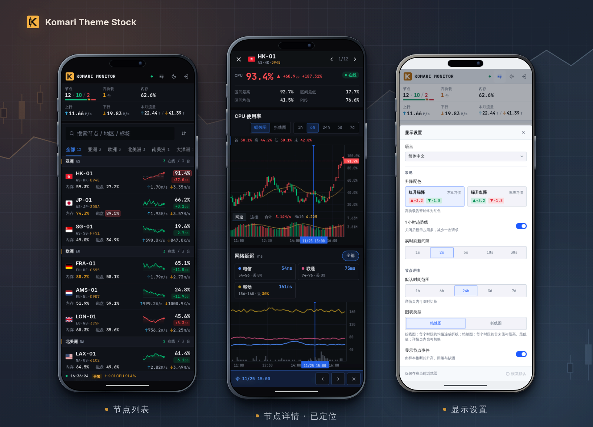

<h1 align="center">Komari Theme Stock</h1>

<p align="center">面向 VPS 运维的 <a href="https://github.com/komari-monitor/komari">Komari</a> 主题，用行情终端式界面查看节点状态与历史指标。</p>

<p align="center"><a href="./README.md">English</a> | <a href="./README.zh-CN.md">简体中文</a></p>

<p align="center">
  <a href="https://github.com/MR-MonkeyRay/komari-theme-stock/actions/workflows/ci.yml"></a> <a href="./LICENSE"></a>
</p>

## 核心亮点

- **快速找到需要排查的节点。** 首页可筛选离线或高负载节点，也支持搜索和排序。节点列表并排显示 CPU、内存和磁盘的当前使用率与近 1 小时趋势，并列出实时网速和流量统计。
- **对照资源与网络变化。** 在节点详情的联动图表上比较 CPU、内存、磁盘和 1 分钟系统负载。CPU 与上下行速率共用时间轴；配置了探测任务后，可按任务查看延迟、丢包和抖动。
- **回溯上报中断。** 点开在线率条上的某一天，可以查看推算出的离线时段。如果历史图表覆盖当天，可跳转到当天并标记首段缺测的起点。

## 快速安装

需要可管理的 Komari 实例。要在启用后立即看到监控数据，请先确认至少有一台节点正在向 Komari 上报。

### 通过 GitHub 仓库地址导入（推荐）

1. 在 Komari 后台打开 **主题管理 → 导入主题**。
2. 粘贴 `https://github.com/MR-MonkeyRay/komari-theme-stock`，依次点 **检测 → 确认导入**。Komari 会从最新发布下载主题 ZIP。

### 手动上传 ZIP

1. 从 [GitHub Releases](https://github.com/MR-MonkeyRay/komari-theme-stock/releases/latest) 下载 `komari-theme-stock-<version>.zip` 附件，不要下载 GitHub 的 **Source code** 源码包。
2. 在 Komari 后台打开 **主题管理 → 上传主题**，选择下载的 ZIP。

导入或上传后，在 **Komari Theme Stock** 卡片上选择 **设为当前主题**。

## 快速开始

1. 打开 Komari 首页，在「全部节点」按节点名、地区或标签搜索并打开节点详情。
2. 在 CPU 图表选择时间范围，把十字线移到峰值处，对照同一时段的 CPU 使用率和上下行速率。
3. 排查缺测时，点开「在线率」条上的某一天。如果有「在图表中查看」按钮，点击后图表会定位到当天；有缺测时会标记首段缺测的起点。

## 界面预览







## 设置与数据口径

- **站点与访客设置：** 后台可选择按大洲（默认）、Komari 节点分组或不分组展示。访客可以切换界面语言、深浅色外观以及蜡烛图或折线图；偏好仅保存在当前浏览器。
- **高负载节点：** 在线节点的 CPU 使用率达到 80%，或内存使用率达到 90%，即计入高负载节点。这个计数不使用 1 分钟系统负载值。
- **在线率与流量：** 每日在线率按小时上报样本数估算，最多显示 30 天，实际范围取决于 Komari 的数据保留期。流量统计只覆盖部分时段时，界面会标明起算日期。
- **续费信息与隐私：** 主题只向已登录用户显示续费信息，但 Komari 的公开节点接口仍可能返回公开节点的金额。若公开站点的金额需要保密，请不要填写。

## 本地开发

使用与 [CI](./.github/workflows/ci.yml) 一致的 Node.js 26，在仓库根目录执行：

```bash
npm ci
npm run dev:mock
```

打开 Vite 打印的地址，即可查看 23 台公开模拟节点，无需 Komari 后端。点「登录」可查看模拟管理视图，访问 `/__mock/logout` 可回到访客视图。

要连接运行中的 Komari 后端，可通过 Vite 代理开发；如果后端监听地址不同，请替换下方地址：

```bash
VITE_API_TARGET=http://127.0.0.1:25774 npm run dev
```

运行 `npm run package` 生成可上传的主题包 `release/komari-theme-stock-<version>.zip`。主题包格式见 [Komari 主题开发指南](https://komari-document.pages.dev/dev/theme)。

## 许可证

[MIT](./LICENSE)
